# Лабораторная работа № 4 - REST API

## Цель работы

Разработать REST API на Spring Boot для хранения владельцев телефонов, их адресов и номеров. Реализовать создание, чтение, полное и частичное обновление, удаление записей, замену и обмен номеров, а также расчёт статистики.

## Архитектура проекта

- **Стек:** Java 21, Spring Boot 3.5.7, Maven, Spring Web, Spring Data JPA, Bean Validation, H2.
- **СУБД:** H2 в памяти (`jdbc:h2:mem:phoneowners;DB_CLOSE_DELAY=-1`). PostgreSQL в проекте не используется. Схема создаётся при запуске и удаляется при остановке приложения. Начальные данные отсутствуют.
- **Основные слои:**
  - `PhoneOwnerController` принимает HTTP-запросы, вызывает сервис и возвращает DTO ответа;
  - `PhoneOwnerService` реализует бизнес-логику, проверяет уникальность номера и управляет транзакциями;
  - `PhoneOwnerRepository` расширяет `JpaRepository` и предоставляет поиск владельца по номеру телефона;
  - `entity` содержит JPA-сущности `PhoneOwner` и `Address`;
  - `dto` содержит модели запросов, ответов, частичного обновления и статистики;
  - `ApiExceptionHandler` преобразует исключения в единый JSON-формат ошибки.
- **Ключевые аннотации:** `@SpringBootApplication` запускает приложение; `@RestController`, `@RequestMapping`, `@GetMapping`, `@PostMapping`, `@PutMapping`, `@PatchMapping`, `@DeleteMapping` и `@PathVariable` описывают REST-маршруты; `@RequestBody`, `@RequestParam` и `@Valid` связывают и проверяют входные данные; `@Entity`, `@Table`, `@Id`, `@GeneratedValue`, `@Column`, `@OneToOne` и `@JoinColumn` описывают модель данных; `@Service`, `@Transactional` и `@RestControllerAdvice` формируют сервисный слой и обработку ошибок.
- **Описание моделей данных и DTO:**
  - `PhoneOwner` содержит `id`, `lastName`, `firstName`, `middleName`, `phoneNumber` и связанный адрес. Номер телефона уникален. Связь с `Address` задана через `@OneToOne` с каскадным сохранением и удалением.
  - `Address` содержит `id`, `postalCode`, `country`, `region`, `district`, `city`, `street`, `house` и `apartment`. Внешний ключ `owner_id` уникален и не допускает значение `null`.
  - `PhoneOwnerRequest` и `AddressRequest` описывают обязательные данные для создания и полного обновления записи.
  - `PhoneOwnerPatchRequest` и `AddressPatchRequest` содержат необязательные поля для частичного обновления. Если поле не передано или равно `null`, сохраняется текущее значение.
  - `PhoneNumberUpdateRequest` содержит новый номер одного владельца, а `PhoneNumberReassignmentRequest` содержит номер владельца-источника и `targetOwnerId` второго владельца.
  - `PhoneOwnerResponse`, `AddressResponse` и `PhoneNumberReassignmentResponse` формируют ответы API без служебной обратной связи между сущностями.
  - `PhoneOwnerStatistics` содержит количество владельцев, стран и городов, самый частый город, самую частую улицу и распределение записей по странам и городам.
  - `ApiError` содержит `timestamp`, `status`, `error`, `message` и `fieldErrors`.

## Алгоритм работы

1. Приложение запускается командой `mvn spring-boot:run` и принимает запросы по адресу `http://localhost:8080/api/owners`. Корневой адрес `/` не является страницей приложения: проект не содержит HTML-интерфейса, поэтому обращение к корню возвращает ошибку `404`. Проверка методов выполняется через `curl` или Postman.
2. `POST /api/owners` проверяет обязательные поля, формат телефона и его уникальность. При успешной проверке владелец и адрес сохраняются одной операцией, ответ получает статус `201 Created`.
3. `GET /api/owners` возвращает список всех владельцев, а `GET /api/owners/{id}` возвращает одну запись. Для отсутствующего идентификатора возвращается `404 Not Found`.
4. `PUT /api/owners/{id}` полностью заменяет данные владельца и адреса. Перед сохранением выполняется валидация и проверка уникальности номера.
5. `PATCH /api/owners/{id}` изменяет только переданные поля. Неуказанные значения владельца и адреса остаются прежними.
6. `PUT /api/owners/{id}/phone-number` заменяет номер одного владельца после проверки его уникальности.
7. `PUT /api/owners/reassign` находит владельца по текущему номеру и обменивает его номер с указанным `targetOwnerId`. Для обхода ограничения уникальности номер источника временно заменяется уникальным служебным значением, после чего обоим владельцам записываются нужные номера.
8. `GET /api/owners/statistics` рассчитывает показатели по всем записям. Query-параметры `country` и `city` необязательны и ограничивают выборку совпадением страны и города без учёта регистра.
9. `DELETE /api/owners/{id}` удаляет владельца вместе со связанным адресом. Успешный ответ не содержит тела и имеет статус `204 No Content`.
10. Ошибки валидации возвращаются как `400 Bad Request` с картой `fieldErrors`. Нарушение уникальности номера возвращает `409 Conflict`, отсутствующая запись возвращает `404 Not Found`, а синтаксически неверный JSON возвращает `400 Bad Request` с сообщением `Некорректный JSON`.

**Маршруты API:**

| Метод | Маршрут | Назначение |
| --- | --- | --- |
| `GET` | `/api/owners` | Список владельцев |
| `GET` | `/api/owners/{id}` | Владелец по идентификатору |
| `GET` | `/api/owners/statistics` | Статистика по всем записям или с фильтрами `country` и `city` |
| `POST` | `/api/owners` | Создание владельца |
| `PUT` | `/api/owners/{id}` | Полное обновление |
| `PATCH` | `/api/owners/{id}` | Частичное обновление |
| `PUT` | `/api/owners/{id}/phone-number` | Замена номера телефона |
| `PUT` | `/api/owners/reassign` | Обмен номеров двух владельцев |
| `DELETE` | `/api/owners/{id}` | Удаление владельца и адреса |

**Правила валидации:** фамилия, имя и отчество обязательны; длина каждого значения не превышает 100 символов. Все восемь полей адреса обязательны. Номер телефона должен содержать от 7 до 30 символов из набора `+`, цифры, круглые скобки, дефисы и пробелы.

## Скриншоты результатов тестирования

### 1. Создание владельца

`POST /api/owners` сохраняет владельца вместе с адресом и номером телефона и возвращает `201 Created`.

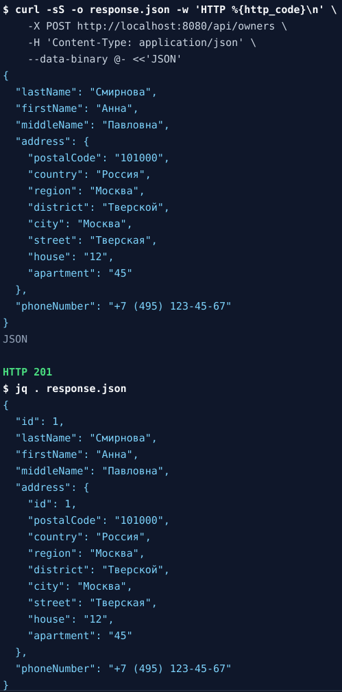

### 2. Список владельцев

`GET /api/owners` возвращает все сохранённые записи. Перед этим запросом через тот же метод были созданы ещё два владельца.

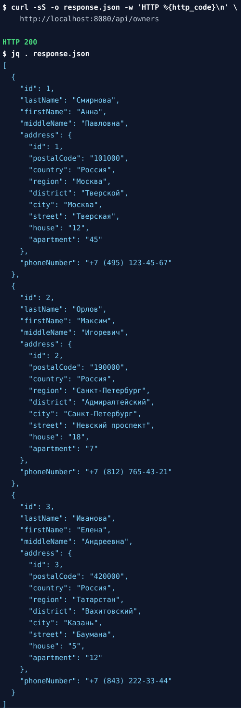

### 3. Получение владельца по идентификатору

`GET /api/owners/1` возвращает одну запись и её адрес.

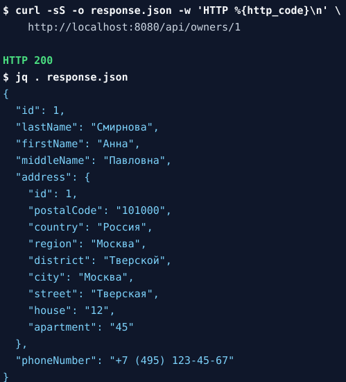

### 4. Полное обновление

`PUT /api/owners/2` заменяет данные владельца и адреса и возвращает обновлённую запись.

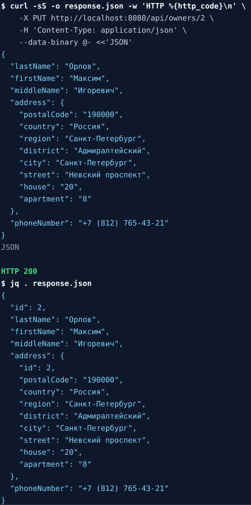

### 5. Частичное обновление

`PATCH /api/owners/2` изменяет только улицу и дом, сохраняя остальные поля адреса и данные владельца.

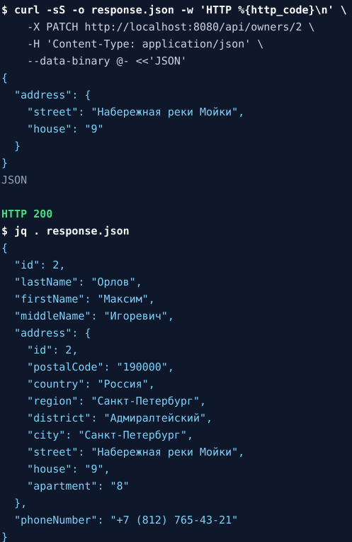

### 6. Замена номера телефона

`PUT /api/owners/3/phone-number` заменяет номер выбранного владельца. В ответе подтверждается новый номер.

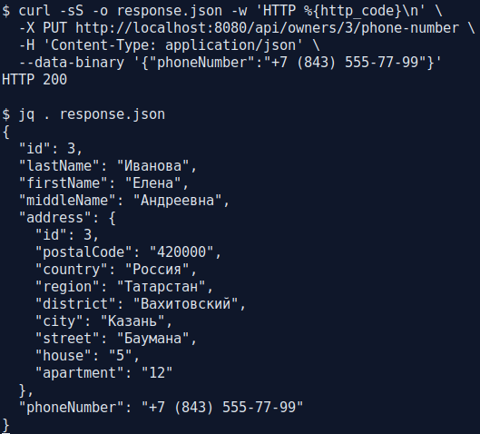

### 7. Обмен номеров телефонов

`PUT /api/owners/reassign` обменивает номера двух владельцев. В ответе показаны оба владельца с новыми номерами.

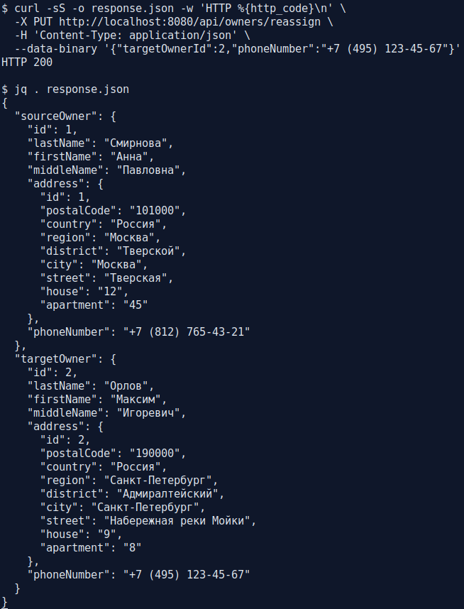

### 8. Статистика

`GET /api/owners/statistics` возвращает общее количество владельцев, стран и городов, самый частый город, самую частую улицу и распределение записей.

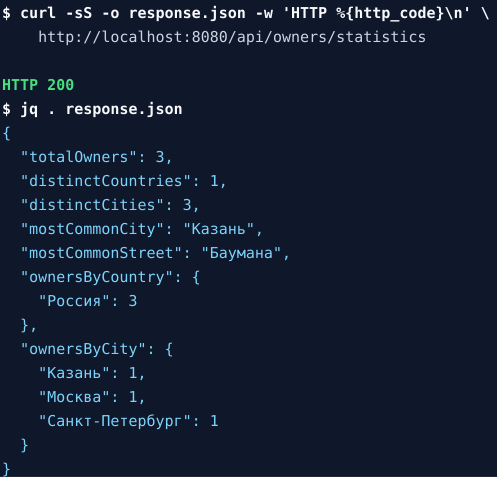

### 9. Статистика с фильтрами

`GET /api/owners/statistics?country=Россия&city=Москва` рассчитывает показатели только по записям, которые удовлетворяют обоим фильтрам.

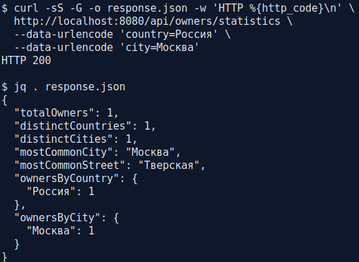

### 10. Ошибка валидации

`POST /api/owners` с пустыми обязательными полями и некорректным телефоном возвращает `400 Bad Request` и перечень ошибок по полям.

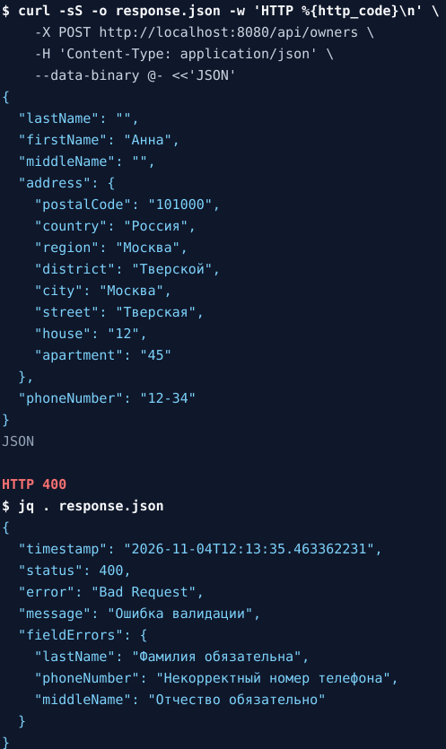

### 11. Конфликт номера телефона

Повторное создание владельца с уже занятым номером возвращает `409 Conflict`.

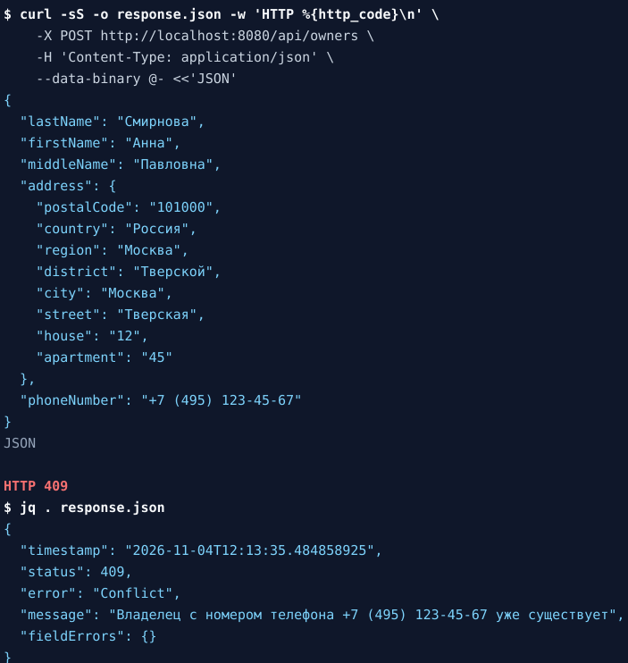

### 12. Запись не найдена

`GET /api/owners/99` возвращает `404 Not Found` с сообщением об отсутствующем владельце.

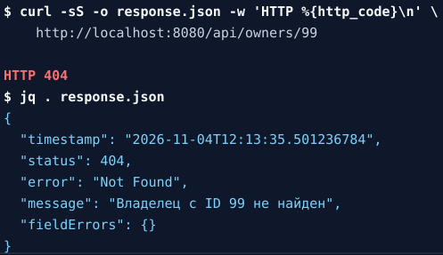

### 13. Удаление владельца

`DELETE /api/owners/3` удаляет владельца и связанный адрес и возвращает `204 No Content`.

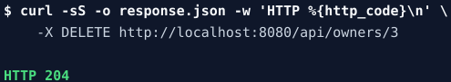
